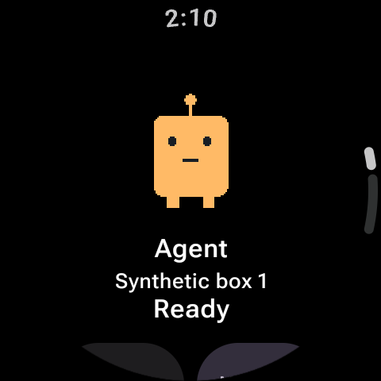
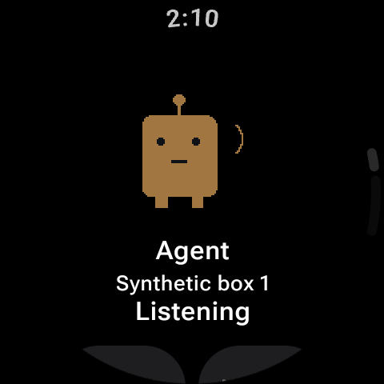
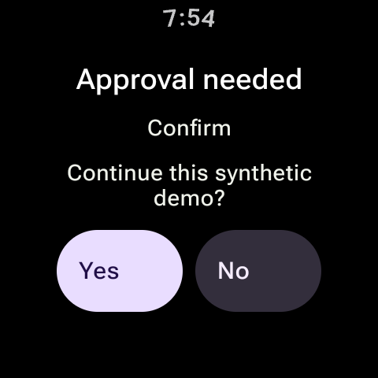

# Quantum Relay for Hermes

**Your own Hermes agent, on your wrist and in your pocket.**

A Wear OS watch app and Android phone app for [Hermes Agent](https://github.com/NousResearch/hermes-agent)
running on your own computer. Hold to talk, read the reply as it streams in, hear it in your
agent's voice, and answer approvals with a tap. No account, no hosted server, no analytics.

<p align="center">
  
  
  
</p>

> **Open beta.** Start with the [install guide](docs/install.md). Feedback goes to
> [Discussions](https://github.com/QuantumInkDev/hermes-gadget-wear/discussions) or
> [Issues](https://github.com/QuantumInkDev/hermes-gadget-wear/issues).

## What you can do

- **Talk from your watch.** Hold the picture, speak, let go. The reply streams in and is
  spoken in that profile's voice.
- **Approve from your wrist.** When Hermes asks to run something, allow or deny it with a tap.
- **Swipe between agents.** Every Hermes profile on every box gets a page with its picture or
  an animated pet that listens, talks and naps.
- **Continue on your phone.** The same conversation, the same session, on the phone (Relay).
- **See every task.** An inbox across all your agents: working, needs input, finished (Relay).
- **Catch up.** Replies that finished while you were offline arrive once you reconnect
  (Relay).
- **Walk and talk.** Walking mode gives short spoken answers on your earbuds, with the full
  text on screen.
- **Shortcuts everywhere.** Watch tiles and complication, phone home screen widgets, quick
  actions, share-to-agent, and handoff between agents.

The [user guide](docs/manual.md) covers every feature. Features marked Relay need the Relay
preview server ([tiers](docs/install.md#what-you-need)).

## How it works

```
 Watch ──(Bluetooth/Wi-Fi)── Phone ──(Tailscale)── Your computer
   └──────────── TLS, from the watch to Hermes ────────┘
```

Hermes runs at home with the Gadget plugin. The watch keeps its own encrypted connection to
it. The phone forwards those bytes over your private Tailscale network and can't read them.
Every device is paired once per profile with a code you approve on your own computer.

## Requirements

- Hermes Agent with the Gadget plugin, on macOS, Linux or Windows
- Tailscale on that computer and on your phone
- Android 10+ phone; Wear OS 4+ watch (optional; tested on Galaxy Watch Ultra)

## Documentation

| For | Read |
| --- | --- |
| Setting it up | [Install guide](docs/install.md) |
| Using it | [User guide](docs/manual.md) |
| Several boxes and profiles | [Profile setup](docs/profile-setup.md) |
| Moving to a new phone | [Move setup](docs/setup-migration.md) |
| Privacy | [Privacy policy](docs/privacy.md) |
| How it's built | [Architecture](docs/architecture.md), [server patches](server/README.md), [relay contract](docs/relay-server-contract.md) |

## Build from source

You need JDK 17, Python 3.10+, Git and the Android SDK (`platforms;android-37.0`,
`build-tools;36.0.0`, `ndk;27.1.12297006`). Set `JAVA_HOME` and `ANDROID_HOME`, or use an
ignored `local.properties`.

```bash
python3 tools/setup-devserver.py
python3 tools/setup-extensions.py
HERMES_GADGET_PYTHON="$PWD/.local/venv/bin/python" \
HERMES_GADGET_EXTENSION_PYTHON="$PWD/.local/extension-venv/bin/python" \
./gradlew check :wear:assembleDebug :mobile:assembleDebug --warning-mode=fail
```

Format with `./gradlew ktlintFormat`. Debug APKs land in `wear/build/outputs/apk/debug/` and
`mobile/build/outputs/apk/debug/`. The phone and watch must be signed with the same key for
them to talk to each other.

| Directory | Purpose |
| --- | --- |
| `protocol/` | Pure Kotlin wire protocol, transports and validation |
| `client/` | Shared client logic |
| `wear/` | Watch app |
| `mobile/` | Phone app |
| `server/` | Gadget plugin patches, Hermes core seams, and the catalog publisher |
| `skills/` | Pet Factory skill |
| `tools/` | Dev servers, pet tooling, store art |

## Contributing and hygiene

Never commit personal endpoints, tailnet names, credentials, signing keys, device identities
or personal art. Keep local setup in the ignored `.local/` folder. Public screenshots use
synthetic profiles and original art only.

## License and affiliation

[MIT](LICENSE). Built on the community [Hermes Gadget SDK](https://github.com/Adolanium/hermes-gadget-sdk).
Quantum Relay is an independent project. It is not affiliated with or endorsed by Nous
Research, Google, Samsung, Tailscale or ElevenLabs.
