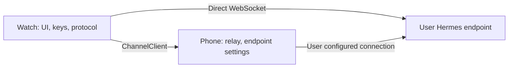

# Architecture

Implemented baseline (2026-10-11): [multi-box profile carousel](superpowers/specs/2026-10-11-multi-box-profile-carousel-design.md).
The phone merges independently refreshed read-only catalogs and synchronizes bounded
portrait/status metadata; the watch retains separate TLS Gadget identities/connections.
Catalog, swipe pages and ambient-safe review development are approved. No new live
server installation or multiplexed routing is implied.

## Native client implementation — 2026-10-12

`client/Appearance` defines explicit semantic palettes; native phone/Wear adapters and
independent device preferences apply them without wallpaper overrides. Phone presentation
surfaces retain the existing repositories, independent phone identity vault, foreground
conversation controller and secure production window. Waveform levels come from actual
capture/playback and reset on cancel/stop/background/profile changes; no animation samples
are stored. Screenshot hosts are non-exported, debug-only, synthetic fixtures.

`WatchNavigation` retains stable page keys, drafts and TransformingLazyColumn state. Picker
Back restores rotary focus without remounting the conversation. `recordingPortrait` owns only
the artwork hold after touch slop/long-press checks. Multi-pointer interruption, ACTION_CANCEL
and disposal cancel owned capture; actual capture state drives rings, not touch-down.
The card footer owns the full-width centered Jump to profile control; the portrait has no
floating picker or microphone badge. Accessible profile actions retain selection locks.
Watch recording feedback prefers a supported predefined tick, with primitive/amplitude/default
fallbacks and system haptic settings retained. Phone recording feedback is unchanged.
`ConversationScreenLease` uses elapsed realtime and a two-minute foreground-turn cap for
FLAG_KEEP_SCREEN_ON. It never renews from meter/status updates or acquires a wake lock.

`TilePinStore` atomically persists Focus, four deduplicated slots, monotonic revision and
accepted request receipts. Field-specific local mutations preserve simultaneous phone edits.
Phone configuration items carry stable keys, base revision and request ID across the existing
associated Data Layer boundary. Stale edits return the current watch state; duplicate requests
return their original acknowledgement. Pending/offline delivery is visible on the phone.
`ProfileTileSnapshot` supplies bounded static resources; `ProfileTileLayout` renders one/four
local shortcuts without network/audio work. `TileProfileLaunch` validates only stable keys,
handles cold/warm binding, and visibly defers locked selection. Ambient takes precedence over
all pending/unavailable launch routes. The existing Focus service component is preserved.

See the [native acceptance record](demo/native-clients/README.md). Emulator transport returned
Wearable.API API_UNAVAILABLE. Subsequent physical associated-watch snapshot readback matches
the existing Focus revision, empty grid and all 19 profile keys; phone edit acknowledgement
remains untested. Reducer/store/native-editor proofs do not replace that remaining transport
gate. The OS power-saver ring case is explicitly capability-skipped; reduced
motion is verified. Physical speech, sleep/reply receipt, tile addition and power cost remain open.

## Verified sources

SDK `v0.2.0` resolves to commit `323e3303ab68981f810fc3208119cd8a22e64af0`. Read in full: [protocol](https://github.com/Adolanium/hermes-gadget-sdk/blob/323e3303ab68981f810fc3208119cd8a22e64af0/docs/protocol.md), [Hermes integration](https://github.com/Adolanium/hermes-gadget-sdk/blob/323e3303ab68981f810fc3208119cd8a22e64af0/docs/hermes-integration.md), architecture, porting, faces, and tailscale-funnel in the same snapshot. Also reviewed the Linux client, simulator transport/conversation, devserver, Python protocol helpers/tests, firmware vectors, and hub handshake/audio routes. Pet evidence is pinned separately in [pets](pets.md).

Corrections to the brief: `linux/client.py` now hosts the native C++ core through `NativeDevice`; it is not an independent pure-protocol client. Kotlin implements the documented wire contract, using the Python protocol helpers and firmware vectors as the oracle. The stock adapter can auto-confirm a deliberate `session.new` within its confirmation window. Streaming `reply.delta.text` is cumulative.

## Modules and boundaries

| Module | Responsibility | Restrictions |
| --- | --- | --- |
| `protocol` | Identity/HMAC, binary framing, JSON envelopes, handshake, heartbeat and negotiation | Pure Kotlin/JVM; no Android; no logs of keys or frames |
| `wear` | Compose for Wear OS, direct socket, Keystore, audio, state/rendering/actions, later surfaces | Owns endpoint device keys and protocol authentication |
| `mobile` | Compose onboarding, endpoint configuration, later relay and BYOK vault | No automatic upload of keys, recordings, or diagnostics |
| `server` | Index of proposed upstream patch series | No replacement stock server or hidden private fork |
| `tools` | Pinned upstream setup and devserver integration helpers, later companion-sheet tooling | Private runtime files under ignored `.local` |

Both Android artifacts use application ID `dev.quantumink.hermesgadget` and must share a signing certificate for the Data Layer; namespaces distinguish watch and phone code. Watch minimum API 33 (Wear OS 4), phone minimum API 29, compile/target API 37. The [current Play policy](https://developer.android.com/google/play/requirements/target-sdk) requires API 36 for phone submissions and at least API 35 for Wear submissions; verified again on 2026-10-06 for M8. No release signing credentials are committed. The watch now declares standalone because direct transport is usable without the phone.

## Protocol and state ownership

An endpoint identity is 32 random bytes, encrypted at rest with a non-exportable Keystore AES-GCM key. Derive `hg-` plus the first 16 lowercase hex characters of SHA-256. First contact sends the Base64 key; enrolled contact sends the HMAC over the literal nonce string. A protocol session is confined to one ordered event stream. Reconnect creates a fresh handshake and discards stale transport callbacks; endpoint switching never shares identity material.

One WebSocket offers `hermes-gadget.v1`. JSON envelopes require a string `type`; known fields are validated and unknown types/fields ignored. Binary frames contain channel, stream, and little-endian wrapping sequence. Stock channels are audio, RGB565 image, and firmware. Optional asset channel 4 is accepted only after extension support is established. Bounds apply before allocating media buffers. An Android app never advertises firmware OTA.

`hello -> challenge -> auth -> welcome` precedes conversation input. `welcome.paired`, `paired`, and `unpaired` control authorization UI. Heartbeat timestamps are echoed; any inbound frame refreshes liveness; three heartbeat intervals without traffic closes the connection. Handshake timeout and exponential backoff are separate from conversation idle disconnect. Backoff resets after a healthy session, never merely TCP open. Prompt guards use monotonic time.

Audio starts as mono PCM16 at 16 kHz, approximately 256 kbit/s of payload per direction. Use AudioRecord/AudioTrack off the main thread, bounded recording and playback buffers, stream/sequence checks, and immediate cancellation. Server pacing is at most 0.5 seconds ahead; allow approximately one second of playback buffering. Stock mic rates are constrained to 4–48 kHz in hub code, rather than arbitrary rates. Missing format selection means PCM16. Future Opus support must inspect MediaCodec availability and codec-specific headers; do not assume raw packets equal Ogg output from a provider.

## Transports and relay trust

The diagram describes reachability, not an encryption guarantee. Stock TOFU sends the key in `auth`; a phone that terminates the watch/server WebSockets sees it. HMAC proves key possession to the server but does not sign conversation frames or authenticate the server to the watch. Therefore keeping key storage on the watch alone does not meet the brief's compromised-phone requirement.

Approved M3 approach (2026-10-06): ChannelClient carries an opaque bidirectional byte stream; the phone forwards TCP bytes, while the watch owns TLS and WebSocket framing end to end. Normal certificate/hostname validation is required. The phone then cannot read enrollment or forge protocol traffic, but can still drop traffic and observe timing. The maintainer requires TLS for the relay and direct fallback under the configured endpoint's rules, and authorizes scoped Tailscale updates to prepare reachability. A stock cleartext-only endpoint needs host-side TLS configured before it can use the relay; the existing explicitly accepted private direct mode remains available.

The phone's Tailscale Android app provides the VPN; no Tailscale embedding is planned for v1. A later `tsnet`/gomobile investigation must cover tailnet authentication, state/key storage, mobile VPN coexistence, battery, binary size, and the exact pinned component licenses before adoption. We do not assume one license covers Tailscale client components, SDK integration, and hosted service terms.

Auto selection prefers a reachable paired phone relay, otherwise a configured direct endpoint; a manual override is visible. Transport handoff must close the old authenticated session before opening another, prevent replay of recorded audio or answered prompts, and never fall back to weaker TLS settings silently.

## Network policy decision

Target API 37 also introduces local-network permission enforcement on Android 17. Before M2 LAN connections, implement and test the applicable runtime permission/rationale flow; do not mistake a denied local-network permission for a TLS or pairing error. See [Android local-network protection](https://developer.android.com/privacy-and-security/local-network-permission).

[Android network security configuration](https://developer.android.com/privacy-and-security/security-config) declares static base/domain rules; arbitrary endpoint names cannot be added to packaged XML at runtime. M2 cleartext support was approved by the maintainer on 2026-10-05: permit it at the watch platform layer and enforce the choice in the sole direct connector. Each `ws` endpoint requires a LAN/tailnet declaration and explicit warning acceptance. The connector rejects public literal addresses and public DNS results for cleartext, disables HTTP proxies and redirects, and never downgrades TLS. Private address classification alone is insufficient: explicit user acceptance is also required. Embedded URL credentials, query strings, and fragments are rejected; access tokens are separate encrypted fields. The phone policy remains TLS-only until M3's independent relay-trust decision.

## M2 implementation plan

The pure JVM layer owns the ordered conversation reducer and direct WebSocket adapter. It bounds queued work, wire messages, PCM buffering, image dimensions/sequence/length, and action duration. Socket generations discard callbacks from closed connections. Reconnect re-authenticates but never replays input, audio, actions, or prompt answers. Cumulative reply previews replace their predecessor; a turn ID filters stale replies. Prompt guards use monotonic time, accept one answer after 600 ms, and reject expired/withdrawn questions.

The watch stores endpoint configuration, optional access token, and per-endpoint random identity in AES-GCM records protected by Android Keystore. Existing identity decrypt failures are errors, not automatic key regeneration. All records use atomic writes, private storage, and the existing backup exclusions. Runtime state, recordings, and incoming images are memory-only.

An activity-bound service owns the connection and Android audio backends. Its binding lasts until activity destruction so Wear's full-screen keyboard preserves the in-memory form and typed-message drafts; screen visibility still controls microphone cancellation and background restrictions. The visible activity requests local-network and notification permissions when applicable. Microphone permission is requested before recording; permission completion does not itself start recording. A fresh hold gesture starts a microphone foreground service. Typed conversations use the media-playback foreground type; the service stops after conversation idle. Leaving the screen cancels an unfinished recording, while an active reply may complete through its foreground service. Nothing starts at boot, and the service is not sticky.

Device actions have strict parameter validation and one bounded result. Vibration and notifications use platform APIs; notifications are advertised only when permitted. Timers delegate to an available system clock and brightness applies only to the visible app window. Unsupported/unavailable actions return an error. Battery is the only sensor advertised. Compose screens use round-safe scrolling, guarded prompt controls, hold-to-talk/swipe-cancel, and a two-second cancel hold for a new session. Standalone metadata changes only when the direct build is demonstrated on a watch emulator; physical Ultra and real-Hermes acceptance remain explicit M2 gates.

## Upstream extensions

See [upstream](upstream.md). Opus negotiation, client TTS, pet delivery, and reconnect outbox are independent optional proposals. Each needs plugin code, protocol documentation, feature-off compatibility tests, and stock gadget tests on a clean branch against the pinned SDK. Unknown optional fields do not change protocol v1. The numbered SDK patches implement optional Opus, pets and client speech in isolated test checkouts; live installations remain unchanged.

Pet PNG assets need explicit length/hash metadata, dimensions and row occupancy, bounded chunking, completion/abort semantics, cache quota, and no client-supplied filesystem paths. Profile multiplexing additionally needs per-profile authorization/storage and gateway registration hooks; it is not implemented based on unit-test-only profile behavior.

## Validation strategy

CI builds both debug apps, runs JVM and Android host unit tests, Android lint with warnings treated as errors, ktlint, and gitleaks. Gradle warning mode and Kotlin warnings fail the build. The wrapper distribution and CI actions are pinned. JVM integration starts the actual SDK devserver in an isolated temp directory, enrolls, approves a synthetic device, reconnects with HMAC, and verifies an echo conversation and PCM loopback. Network/runtime details are ephemeral and omitted from committed reports.

Hardware checks remain separate: Ultra mic/playback, round clipping, prompt accidental-press prevention, Bluetooth relay loss/backpressure, VPN reachability from the phone, Opus bitrate/STT, standby battery, ambient burn-in, and signed Play internal-track installation.

M2 idle policy: ordinary inactivity disconnects after 90 seconds. A stalled active turn or unanswered prompt has a 120-second inactivity cap, including during retries, so heartbeats cannot keep a foreground service alive indefinitely. Offline state preserves the last reply.

Typed drafts stay in memory when idle or network loss closes the connection. The editor shows connection status and an explicit Connect control, then requires a fresh Send after reconnecting. It clears a draft only after the connection event queue confirms that the text frame was accepted by the active WebSocket. Rejected, stopped, or overloaded submissions leave the draft available. This local acceptance result does not claim delivery acknowledgement from the stock server, and input is never replayed automatically.

## M3 implementation plan

The common relay implementation forwards TCP bytes over one ChannelClient stream per connection. To use Android's normal TLS implementation without pretending a Data Layer stream is a native socket, the watch starts a loopback-only HTTP CONNECT bridge. OkHttp connects through that local bridge and performs TLS/hostname validation for the original server. The local CONNECT request is limited to the configured authority and guarded by a random, per-bridge proxy token; the token stays on the watch. The phone receives only the configured endpoint header and opaque TCP payload, never a device identity or authentication helper. Both copy directions use fixed buffers, blocking backpressure, bounded concurrency, and close together on cancellation/error. Headers, raw bytes, private endpoints, and failures are not logged.

Channel discovery uses a versioned companion capability, matching package IDs and signatures, and reachable nodes. Auto mode tries a reachable relay before direct; a manual choice is visible. Relay opening and fallback are generation-guarded, close the prior connection, and do not replay input. TLS validation/authentication failures do not trigger a weaker fallback. Cleartext relay is excluded by the maintainer's approved TLS requirement. A phone-side local-network permission or foreground-service denial is a surfaced relay failure, not a TLS bypass.

Validation starts with a JVM end-to-end TLS/WebSocket demo through two byte bridges to the unmodified SDK, checks certificate rejection and header/authority/buffer limits, then Android loopback/TLS instrumentation. The later [physical report](physical-results.md) records actual ChannelClient relay, Tailscale cellular reachability and foreground behavior. Bluetooth-specific throughput remains open.

Physical continuation plan (2026-10-06): the unfiltered single-device companion request
offered an unrelated nearby Bluetooth device. Use Android's device list so the owner can
select their actual watch before granting background privileges. Android documents that
[`setSingleDevice(true)` stops at the first matching device](https://developer.android.com/reference/android/companion/AssociationRequest.Builder#setSingleDevice(boolean));
an unrestricted filter cannot identify the intended watch. Verify the corrected chooser
on the phone, then exercise forced Phone TLS, reviewed setup import, background startup,
cellular/VPN access and bounded interruption. Preserve existing endpoint identities and
publish only sanitized physical results.

## M4 design plan

Opus is optional and explicitly negotiated per direction in `welcome.audio`; an absent choice is PCM16. The watch advertises Opus only after a real MediaCodec configuration/round-trip probe for mono 16 kHz, 20 ms, 24 kbit/s succeeds. Keep an OpusHead codec configuration separate from raw packets; wire binary audio frames each contain one packet. Supply decoder codec delay and preroll through the platform CSD fields. Android decodes at 48 kHz for AudioTrack; wire uplink/source PCM remains mono 16 kHz. All capture/playback tokens and byte/packet/time limits remain enforced. Codec failures cancel the current recording/playback; no automatic input replay or mid-stream format switch.

The SDK extension is opt-in, with stock behavior unchanged when disabled or unsupported. Prefer the existing ffmpeg binary, check its Opus support, and use bounded pipes without shell commands. Uplink reconstruction wraps ordered packets in Ogg pages with CRC, 48 kHz granules and encoder pre-skip, then decodes off the event loop into the existing PCM/WAV STT path. Downlink feeds resampled PCM to a persistent ffmpeg encoder, parses bounded Ogg pages into raw packets, and retains the existing playback lead pacing. Provider Ogg/Opus output must be demuxed rather than forwarded as packets. Prove software round trips and extensions-off stock compatibility before any live installation; keep the Ultra bitrate, latency and same-utterance STT measurements open until hardware is available.

Opus CSD parsing was checked against Android's [OpusHeader implementation](https://android.googlesource.com/platform/frameworks/av/+/ec660f185a1e212b1d22125de81e9bd1d0ff58a3/media/libstagefright/foundation/OpusHeader.cpp), and raw-packet durations against [RFC 6716](https://www.rfc-editor.org/rfc/rfc6716.html). Codec-specific configuration is not a media packet.

Physical codec correction plan (2026-10-06): the Ultra passed native 48 kHz provider
decoding, but both three-second burst tests exhausted decoder input buffers after the
single 10 ms wait. Drain available output while retrying input-buffer acquisition within
a bounded deadline, including acquisition for end-of-stream. Keep packet order and
timestamps intact. Android's [MediaCodec buffer contract](https://developer.android.com/reference/android/media/MediaCodec)
requires output buffers to be released so a codec can continue. Verify the existing
failing burst/cross-codec tests and the passing provider case on the same watch; preserve
the stock PCM fallback and all personal endpoint identities.

## M5 design plan

Pet delivery is an optional authenticated extension: advertise channel 4, request after pairing, accept a bounded manifest and two explicitly identified PNG assets (base plus optional companion). Assets have start/end/abort, exact stream/sequence/length/hash validation, a 15-second inactivity timeout and compressed/decoded geometry limits. Stock servers may ignore the request, so conversation startup never waits for it. The SDK opt-in adapter resolves the current profile's active pet, safely confines metadata paths, transcodes WebP to PNG with alpha and trims blank trailing cells. It never changes the base atlas taxonomy.

The watch checks PNG dimensions before decoding, caches by endpoint/hash with a global quota, and prepares nearest-neighbour frames off the UI thread. State mapping follows `docs/pets.md`; companion listening/talking/sleeping rows are optional. Talking uses playback amplitude with hysteresis, while missing rows use the documented base-row/bob fallbacks. Original procedural sample art is permitted; no personal or Hermes mascot art enters this repository. Companion-sheet tooling measures the base idle alpha bounds, matches shared row scale/baseline, rejects clipping/drift, and leaves the base sheet unchanged. Software tests cover corruption, malformed/partial transfer, missing companions, taxonomy and geometry; real pet legibility/ambient power remain hardware gates.

## M6 design plan

BYOK is explicitly selected per endpoint on the phone; default server speech stays
unchanged. Shared and endpoint-specific keys/voice overrides live only in an atomic
AES-GCM Android Keystore vault on the phone. Nonsecret readiness records synchronize
over Data Layer; no key or device identity enters those records. The watch advertises
`caps.tts:"client"` only for an active phone relay with matching BYOK readiness, and
only uses it if the opt-in server acknowledges `welcome.tts:"client"`. Direct/no-phone
connections and stock servers keep server speech. A lost phone cancels speech and
surfaces the failure; reconnecting direct negotiates server speech again, never replaying
input or silently submitting the same text twice to a paid provider.

The server extension suppresses automatic server TTS for acknowledged client sessions,
sends a bounded optional profile voice hint and a distinct once-only `tts.speak` event
for final replies, and leaves text display/streaming intact. Interim deltas, transcripts
and duplicate final events must not create repeat synthesis. The watch sends final reply
text through a separate bounded ChannelClient stream to the phone. This optional feature
explicitly discloses reply text to the phone and ElevenLabs; Hermes enrollment/auth stays
inside watch-owned TLS. The phone calls only the fixed ElevenLabs HTTPS origin, rejects
redirects, sends its key in the API header, and uses bounded cancellable streaming audio.
Prefer provider-native Ogg Opus where supported, demux/validate packets rather than
forwarding container bytes, and retain mono PCM16 fallback for watches without Opus.
One paid request per explicit speech event, no automatic provider retry. API/stream
failure leaves the readable reply with a concise notice. Stop/record/profile switch
closes the channel and request. The connected-device foreground service exists only
while relay/audio channels are active.

The phone's Test key button performs a read-only subscription request and displays
reported remaining quota or permission/availability status; development uses mocks and
original synthetic audio, never existing personal ElevenLabs credentials or billable
calls. Provider references: [stream speech](https://elevenlabs.io/docs/api-reference/text-to-speech/stream)
and [subscription](https://elevenlabs.io/docs/api-reference/user/subscription/get).
Hardware Data Layer, actual provider output/voice/quality and billing remain explicit gates.

## M7 design plan

V1 stores at most 32 endpoint profiles (original limit: eight). The watch's encrypted catalog contains each URL,
label, access token and approved transport/cleartext policy; its encrypted active record
remains compatible with the M2–M6 single-profile setup. Migration imports that record once
and validates the existing endpoint identity before saving the catalog. Each URL has an
independent random device key; selecting, editing labels/tokens or removing a profile must
never rotate another endpoint's key. Removal forgets settings and cache but retains the
identity until explicit whole-vault reset, so re-adding the URL cannot silently replace
server enrollment. Missing/tampered keys require explicit reset, never regeneration.

The phone offers encrypted endpoint setup and sends only user-configured setup (including
an explicitly entered optional access token) over the same-package Data Layer. Watch keys,
HMAC and ElevenLabs keys are excluded. A bounded import page on the watch requires reviewing
and accepting the selected endpoint before saving; imported cleartext warning acceptance
is always reset on the watch. No inbound setup can switch the active profile or replay input.
Profiles switch on a dedicated scroll/rotary list accessible by a horizontal swipe or a
button. Switching stops/cancels prior media and closes the old transport, clears prompts,
reply and draft, loads the selected endpoint's cache and starts a fresh handshake.

Multiplexed gateway v2 remains a proposal. It needs a host gateway spanning profile homes,
profile-scoped stores, authorization and lifecycle, which the stock root plugin does not
provide. Document the wire and migration questions; implementation and outreach wait for
an explicit maintainer decision and upstream feedback. Real multiplexed behavior cannot be
claimed from independent v1 endpoints or unit tests.

## Historical M8 design baseline

Tile and short-text complication expose a local snapshot and launch the app; they never
open sockets, start a microphone or synthesize speech in the background. Connection/pet
state is process-local and becomes Offline after process death. The original M8 tile used an
encrypted, bounded 120-character last-reply snapshot, isolated on profile switch and cleared
by whole reset. The native Focus/grid design supersedes that tile presentation. A complication
shares only generic state with the selected watch face, never reply text, URLs or keys.
Update on meaningful state changes with throttling; no periodic network polling.

Ambient replaces the interactive composition with a static sparse monochrome outline of
the current pet's idle frame (procedural robot if absent), with a minute tick pixel shift
only when the system is not already providing burn-in shifting.
No pet animation, mic gesture, haptics or reply text remains in ambient. Respect low-bit
anti-aliasing constraints and keep the outline within the round safe area. Existing idle
connection timeouts remain; entering ambient cancels capture. Only a user-started active
conversation/playback may retain a foreground service, and it is released after the turn
and actual audio drain, not kept for a ready idle screen. No wake lock or boot autoconnect.

Release prep produces unsigned release app bundles, dependency/build evidence, a synthetic
round-screen capture set, privacy/Data Safety drafts, self-host/Quick Button instructions
and an explicit hardware/release checklist. It does not invent a signing identity, publish
a privacy URL or upload to a Play account. The internal track, Ultra battery/quality tests,
real relay/import/BYOK and Play review remain gates until their prerequisites are available.
The pinned AndroidX Tiles/ProtoLayout/complication APIs and official ambient guidance were
checked against current primary documentation before implementation.

## Multi-source carousel implementation

The standalone publisher projects owner mappings without opening a Gadget session. Catalog
source credentials live only in the phone's separate AES-GCM vault. HTTPS/hostname checks,
no redirects, source-bound asset paths, 32-profile/64 KiB envelopes and bounded fanout keep
discovery separate from enrollment. Partial responses persist and publish independently; generation
checks discard work invalidated by source edits. A conflicting or oversized merged source
update becomes Attention with its prior cards retained; healthy sources continue. Owner order
survives offline and withdrawn records. Catalog reachability is displayed separately from the Gadget connection status.

The phone persists legacy owner-selected fallbacks separately from source metadata, preserving
them through portrait-less refreshes and restarts. Explicit watch-specific overrides are stored
in a separate encrypted record keyed by source/profile identity. Keep raw box portrait metadata
beneath the effective override so a later refresh updates it and returning to the box picture
can restore the latest cached image without another download. Overrides work on setup-needed
cards and do not change URLs or pairing. Protect/cache both referenced images and retire only
unreferenced choices on confirmed removal. Image ingestion
enforces the 8 MiB limit while protecting committed fallbacks; final/failure cleanup removes
unreferenced files. Owner-confirmed forgetting of a withdrawn catalog card recovers historical
capacity; phone/watch endpoint setup and URL-scoped identity files remain independent.

The phone publishes normalized portrait assets before the version-1 roster, then deletes
only its own unreferenced portrait Data Items. Replacement metadata must succeed first;
other nodes and namespaces remain untouched. Publication has a shared five-second deadline.
The isolated direct-TLS publisher installs accepted-socket timeouts before handshaking and
allows at most four request workers. The phone answers an on-demand bounded refresh channel. The watch restores its separate encrypted roster/selection before rendering/connection
effects or requesting remote refresh. It keeps a
verified atomic portrait cache and approved URL vault; metadata cannot enroll a new URL.
Only selected and adjacent artwork is prepared on bounded workers. The settled approved
page selects one URL-scoped conversation; recording/approval disables page changes and
prior epoch guards reject old callbacks. Memory-only drafts are bounded per URL. Navigation
and unfinished setup fields are activity-owned above ambient replacement. The selected
foreground pet crossfades in a fixed area, while ambient uses its static monochrome outline.
Portraits use a 160 dp square inside a fixed 160 by 168 dp artwork frame, doubling their
original 80 dp diameter. The frame keeps that size through the round page's text gutters;
names and controls remain below it in the scrollable page. Pets retain their existing
96 by 104 dp canvas centered in that frame. Portrait conversation/discovery pages use 28 dp
top padding to center the enlarged circle beneath the clock; approval/setup screens keep
their existing 40 dp top padding.
There are no new periodic idle/ambient discovery timers. Real paired-device portrait/catalog transfer, per-profile cellular TLS replies and controlled
catalog outage/return are recorded in [physical results](physical-results.md). Whole-box power
transitions, physical speech/pets, radio and battery acceptance remain separate from the
[synthetic demo](demo/carousel/README.md).

## Approved independent phone client — 2026-10-12

The [follow-up design](superpowers/specs/2026-10-12-client-usability-design.md) adds a
phone-owned DirectConnection session beside the opaque watch relay. A separate Android
Keystore vault namespaces phone Gadget identities by canonical endpoint; catalog credentials
and watch identities never enter it. Shared Android PCM/Opus adapters move out of the watch
module into a small Android client library, leaving the protocol module pure JVM.

The phone's retained conversation model owns a single current socket and epoch-guards its
callbacks. Leaving/locking the foreground conversation closes that socket and stops its
audio while leaving RelayService alone. The directory groups stable source/profile keys
and persists owner sorting in the catalog vault, publishing the same flattened order to
the watch. Portrait lookup uses the existing effective, hash-addressed local cache.
Watch page list state is activity-owned and keyed by stable page; prompt lists are separate.
These are approved component boundaries; passing implementation evidence belongs in progress.

Recording cue implementation lives in the shared Android `client` module. Capture readiness
is reported after AudioRecord starts; buffered samples spanning the cue are discarded before
frames are forwarded. Recorder release precedes stop/finish callbacks; capture generation and
connection epochs reject replaced-session callbacks. MediaCodec Opus remains the watch path;
the initial phone path advertises PCM only. A bounded versioned Data Layer item replicates
only the sound-enabled preference and timestamp, never endpoint or enrollment material.

## Animated portrait overrides and recording outcomes

GIF overrides retain the existing version-1 PNG roster. A separate optional
`/hermes/animations/v1` manifest binds stable page keys to GIF hash, exact encoded length
and PNG fallback hash; assets use `/hermes/animation-assets/v1/`. The protocol parser validates
LZW pixels and bounded frame/timing data before Android decoding. Phone override metadata
uses a new encrypted record without changing existing aliases or encryption AAD. Asset
publication precedes manifest publication; failed publication keeps the prior GIF protected.
One durable pending import, at most 256 KiB, is separate from the settled 32-file/8-MiB cache.
After successful publication, unreferenced assets retire and the pending import is promoted.

Watch cache admission is checked atomically with roster retirement/reset. Network fetches
remain outside that lock; an expired admission cannot repopulate a retired page. The watch
prepares selected/adjacent artwork, validates hash/length/fallback association, and decodes
animation off the UI thread. Only the selected available resumed page runs an
AnimatedImageDrawable. Reduced motion, power saver, previews and ambient retain static
fallbacks. Endpoint pets remain higher priority than a portrait override.

Recording feedback waits for both recorder shutdown and the token's accepted protocol outcome.
Short captures, rejected sends and cancellation use cancellation feedback; the automatic
recording limit uses completion feedback only after an accepted finish. Tokens and connection
epochs suppress obsolete callbacks. Phone playback uses a player per stream and atomic,
epoch/stream-guarded completion updates, so stopping/leaving a conversation does not acquire
the session monitor from the playback monitor. Neither phone conversation teardown nor
portrait import touches the independent watch relay or watch pairing records.
