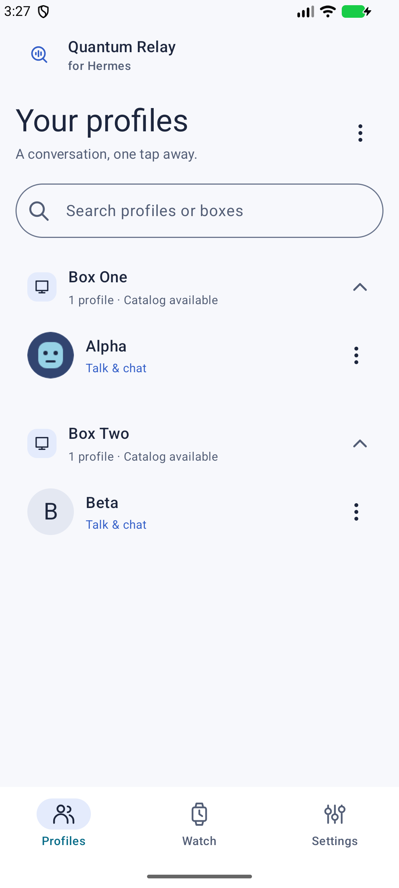
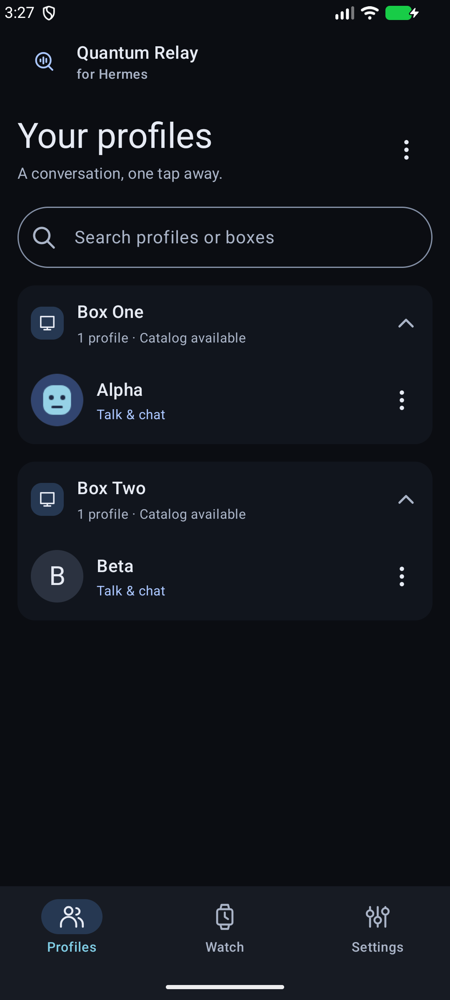
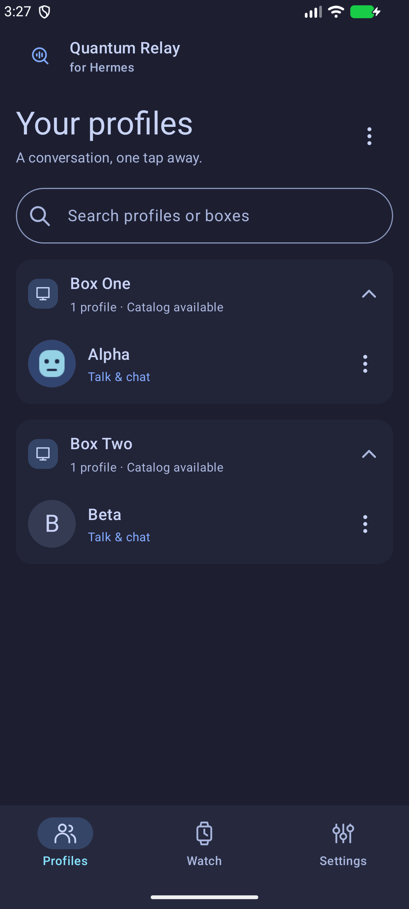
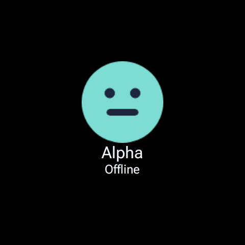
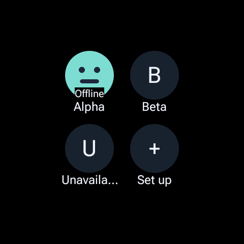

# Quantum Relay for Hermes — native acceptance

These are actual Android/Wear OS renders with original synthetic data. They demonstrate the
implemented native clients, not the interactive design prototype. Phone captures use the
non-exported debug `AppearanceTestActivity`; the production phone retains `FLAG_SECURE`.
No personal artwork, endpoint, conversation, credential or device backup is included.

The [manifest](manifest.json) records origin, dimensions and SHA-256 for every PNG. Unchanged
reviewed Task 1/2/6/8 receipts are reused; Task 7 refreshes the phone surfaces after tile editing
was added. The final fix refreshes 72 watch captures after correcting settled clock visibility;
unchanged phone, ambient, recording and tile images are reused. AndroidX
[TileRenderer](https://developer.android.com/reference/androidx/wear/tiles/renderer/TileRenderer)
renders the exact production ProtoLayout/resources in a synthetic host; those images do not
claim system-carousel addition. Original [Voice Q masters](../../store-assets/voice-q/manifest.json)
and launcher artwork remain separate from personal portraits.

## Three appearances

| Light | Dark | Electronic Moonlight |
|---|---|---|
|  |  |  |

| Native phone surface | Light | Dark | Moonlight |
|---|---|---|---|
| Talk/Chat | [Open](phone/conversation-light.png) | [Open](phone/conversation-dark.png) | [Open](phone/conversation-moonlight.png) |
| Keyboard and Send | [Open](phone/keyboard-light.png) | [Open](phone/keyboard-dark.png) | [Open](phone/keyboard-moonlight.png) |
| Speaking waveform/muted hint | [Open](phone/speaking-light.png) | [Open](phone/speaking-dark.png) | [Open](phone/speaking-moonlight.png) |
| Permission error | [Open](phone/error-light.png) | [Open](phone/error-dark.png) | [Open](phone/error-moonlight.png) |
| Watch and relay | [Open](phone/watch-light.png) | [Open](phone/watch-dark.png) | [Open](phone/watch-moonlight.png) |
| Settings | [Open](phone/settings-light.png) | [Open](phone/settings-dark.png) | [Open](phone/settings-moonlight.png) |
| Boxes setup | [Open](phone/boxes-light.png) | [Open](phone/boxes-dark.png) | [Open](phone/boxes-moonlight.png) |
| Manual setup | [Open](phone/manual-light.png) | [Open](phone/manual-dark.png) | [Open](phone/manual-moonlight.png) |
| Speech settings | [Open](phone/speech-light.png) | [Open](phone/speech-dark.png) | [Open](phone/speech-moonlight.png) |
| Appearance choices | [Open](appearance/mobile-light.png) | [Open](appearance/mobile-dark.png) | [Open](appearance/mobile-moonlight.png) |

All `phone/*-large.png` captures use the **actual 320-dp platform width and fontScale 1.8**,
including real native dialogs and the IME. The test verifies Send lies above the keyboard and
invokes its callback. [Long-label details](phone/profile-details-large-narrow.png) wraps the
endpoint and Close returns to the directory without opening a conversation. The permission
notice is asserted visible after closing connection details. Taller setup pages scroll; a
screenshot showing only their top section does not claim every field fits at once.

The [contrast calculation](contrast.json) covers 120 explicit foreground/container relationships:
normal text ≥4.5:1 and enabled outline boundaries ≥3:1. It extends beyond the prototype's nine
pairs to raised surfaces, selection, supporting accents, warning/error and inverse roles.
Existing native adapter tests independently verify resolved Material color roles, scaffold
foreground and Light watch time text. Disabled controls are visually reviewed but are not
claimed to meet the enabled-text target. The actual keyboard is OS-owned; native tests verify
composer/Send visibility and interaction above its settled window.

## Watch and static shortcuts

The `watch/` captures show the final picker, portrait, reply and clear end padding in all
three themes at fontScale 1.0/1.3. The native layout run uses a 480-pixel round AVD at densities
340/360/400, corresponding to approximately 226/213/192 dp; the first matches the tested Ultra
geometry. Larger labels/source may require vertical scrolling. Portrait, name and source
positions are preserved. A bottom-edge indicator appears only when its complete band is clear
of visible list content; the visible picker disappears once the portrait scrolls. Position/count
and a named Choose a profile accessibility action remain available, including while dots are
hidden. The regression opens the picker through that action, dismisses with Back, and verifies
rotary focus, mounted scroll state and busy/approval/recording locks.

| Final watch surface (Ultra-equivalent geometry) | Light | Dark | Moonlight |
|---|---|---|---|
| Portrait | [Open](watch/density-340/light-1.0-portrait.png) | [Open](watch/density-340/dark-1.0-portrait.png) | [Open](watch/density-340/moonlight-1.0-portrait.png) |
| Picker | [Open](watch/density-340/light-1.0-picker.png) | [Open](watch/density-340/dark-1.0-picker.png) | [Open](watch/density-340/moonlight-1.0-picker.png) |
| Scrolled reply | [Open](watch/density-340/light-1.0-reply.png) | [Open](watch/density-340/dark-1.0-reply.png) | [Open](watch/density-340/moonlight-1.0-reply.png) |
| End padding and dots | [Open](watch/density-340/light-1.0-end-padding.png) | [Open](watch/density-340/dark-1.0-end-padding.png) | [Open](watch/density-340/moonlight-1.0-end-padding.png) |

[Ambient](watch/ambient.png) stays static and black. The actual-activity unavailable-launch
ambient regression separately proves real sleep/wake precedence; the older unchanged ambient
image is reused. The `recording/` images cover static pictures, a normalized original two-frame
GIF and a synthetic pet, all themes, enlarged text and reduced motion. Phase pairs show rings
moving only outside the unchanged 160-dp portrait. Actual capture starts the rings; short taps,
pre-hold motion, a second pointer, ACTION_CANCEL, downward cancel and disposal cannot send an
unintended recording. The new second-pointer and ACTION_CANCEL cases each cover before/after
hold ownership, no finish and at most one cancellation after start. ACTION_CANCEL also verifies
a fresh deliberate hold after the cancelled streams.

| Focus | Pinned profiles |
|---|---|
|  |  |

Tile rendering uses only static local resources. Native renderer assertions verify separated
48-dp-or-larger targets and visible text. The grid intentionally truncates long labels while
preserving full accessible names; unavailable keys are not redirected. The original synthetic face passes through the real portrait cache and circular snapshot
normalization before the inline resource renderer; initials test the missing-art fallback.
The `phone-tiles/` captures show the normal native editor and pending delivery at fontScale
1.0/1.3 in each appearance. Watch revisions, duplicate/stale requests, offline retry and
concurrent local/phone edits have separate native store/editor and JVM coverage.

## Checks and limitations

The final fix passed 116 JVM tests across 33 XML reports with zero failures/errors/skips.
The single final strict run completed 214 Gradle tasks in 14 seconds with zero warnings and
built both debug APKs and both instrumentation APKs:

```sh
./gradlew ktlintFormat check :mobile:assembleDebug :wear:assembleDebug :mobile:assembleDebugAndroidTest :wear:assembleDebugAndroidTest --warning-mode=fail --max-workers=4
```

The final fix records 34 passing focused native executions (32 distinct methods), including
18 clock theme/font/density scenarios. The clock remains hidden over settled scrolled content;
the original 160-dp artwork and first-view identity geometry remain unchanged. Catalog changes
retain the mounted active turn and approved session until recording/reply/approval locks clear.
Phone lookup runs off the UI thread, publication releases the repository monitor, and in-flight
portrait assets remain bounded and protected until ordered replacement. Real secure MainActivity
checks verify responsive Talk/navigation, stop/resume cancellation, source-collapse pruning and
query/collapse/exact row position after Talk/Back and Settings/Back. Sprite pets now share the
observed reduced-motion/lifecycle/power policy used by GIFs.

Earlier Task 7 checks cover real two-pointer/cancel events and static native tile rendering.
The [verification record](verification.json) identifies final checks,
reused receipts and capability limits. Warning-strict Gradle runs use JDK 17 and the existing
pinned stock/extension Python environments. Device tests use only guarded owned emulators and
a worker-owned ADB server; physical setup and personal captures are excluded.

Actual OS battery saver could not be enabled on the owned Wear AVD: that case is explicitly
capability-skipped, not passed. Reduced-motion static output is verified. Associated Data Layer
configuration delivery remains unverified because the paired-emulator attempt returned
`Wearable.API API_UNAVAILABLE`; reducer/native store/editor checks do not replace transport proof.

The historical away trial established generated server replies and short sleep cycles, not
watch receipt or a proven cause. A native stock-localhost 20-second delayed reply passes beyond
the synthetic 15-second display timeout and releases the bounded foreground screen flag after
completion. Physical away speech/reply/sleep behavior remains open.

Physical delivery is recorded separately in [release preparation](../../release.md) and
[session status](../../../SESSION_STATUS.md). Whole-branch review and its single fix-wave scoped re-review pass; see the
[review resolutions](../../native-client-review.md). The physical watch received the corrected
preserving build and normal Moonlight/Focus setup. Phone preserving delivery, four grid choices,
physical tile addition/every target launch,
speech/haptic strength/microphone contamination and quantitative Light/GIF/audio/battery tests
remain controller/owner gates. Eighteen prior normal owner GIF imports/assignments are already
verified privately; they are not reimported or included here. No Play release is claimed.
